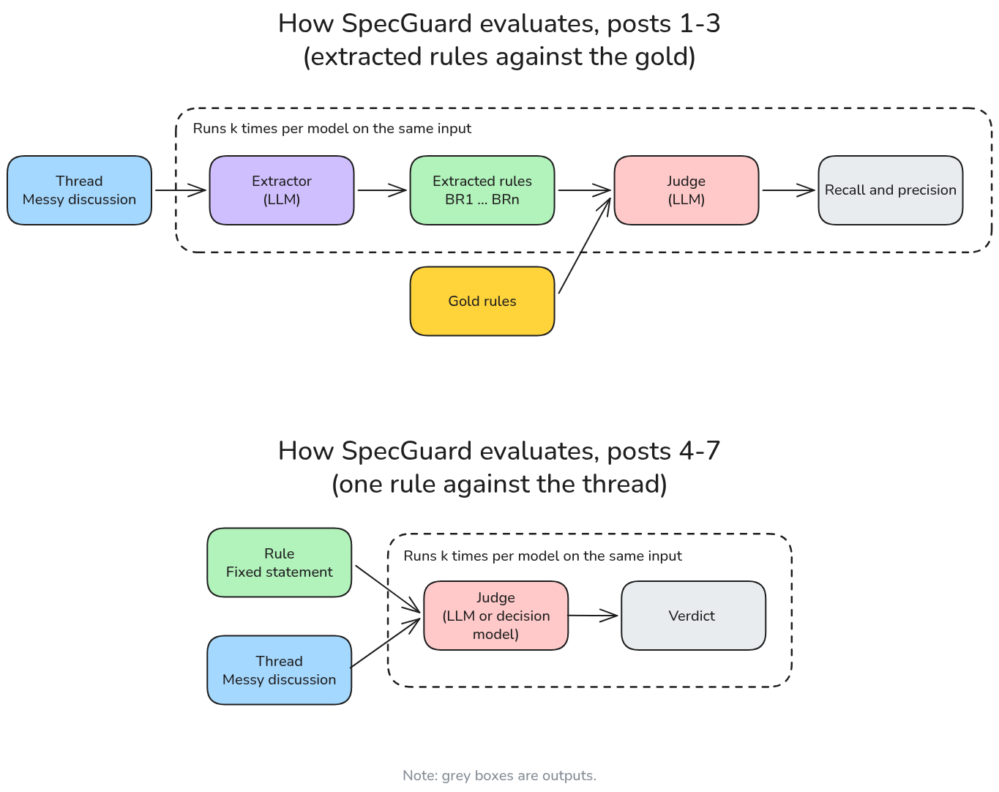
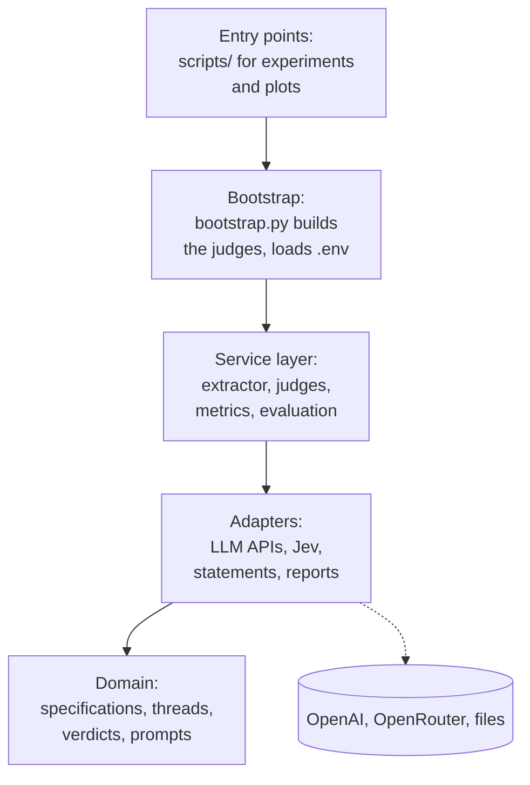

# SpecGuard

[](https://github.com/carlosserratoro/specguard/actions/workflows/ci.yaml)

[](LICENSE)
[](https://mypy-lang.org/)

SpecGuard is an AI tool that turns messy feature discussions between consultants into structured specifications.

I was building its first version while documenting the findings in a series of posts. During the series, SpecGuard changed what it evaluated.

In posts 1-3, an extractor (an LLM) reads a conversational thread and outputs the business rules, and a judge (an LLM) compares them with a gold specification written by hand: recall measures how many gold rules were found, precision measures how many of the extracted rules are real (i.e. not invented). In posts 4-7, the focus moved to the judge itself: given one fixed rule statement and the thread, the judge (an LLM or, in post 7, a decision model) says whether the thread supports the rule, contradicts it or doesn't state it. Every model call is repeated k times on the same input, because [a single run says little](https://www.linkedin.com/pulse/demo-you-saw-run-1-carlos-serra-toro-jh0ne/). Each run produces one result, and the posts report their distribution.

 <!-- The .png embeds the Excalidraw scene -->

## The series

As of now, the tool is still being improved (see the end of this README, where I outline the next steps).

The table below lists the posts that tell the evolution. Next to each post you'll find its main finding and the Git tag with the exact code and results behind it. To get them, run `git checkout <tag>`.

| # | Post | Finding | Tag |
|---|------|---------|-----|
| 1 | [The demo you saw was run 1](https://www.linkedin.com/pulse/demo-you-saw-run-1-carlos-serra-toro-jh0ne/) | Same input, 20 runs: recall ranged from 0.643 to 1.0. Run 1 was perfect; run 19 lost more than a third of the rules. | [`post-01-sampling-matters`](https://github.com/carlosserratoro/specguard/releases/tag/post-01-sampling-matters) |
| 2 | [Why LLMs miss requirements: it starts in the meeting](https://www.linkedin.com/pulse/why-llms-miss-requirements-starts-meeting-carlos-serra-toro-x5c2e/) | Failures are not random: three rules account for all the errors, and the most missed one needs the most reasoning. | [`post-02-failures-are-not-random`](https://github.com/carlosserratoro/specguard/releases/tag/post-02-failures-are-not-random) |
| 3 | [Why my LLM judge rejected a correct business rule](https://www.linkedin.com/pulse/why-my-llm-judge-rejected-correct-business-rule-carlos-serra-toro-zfshe) | The extractor wasn't losing the rule, but the judge was rejecting one of its two equivalent forms (3/11 accepted, against 19/19). | [`post-03-br2-framing`](https://github.com/carlosserratoro/specguard/releases/tag/post-03-br2-framing) |
| 4 | [It wasn't the gold. It was the judge](https://www.linkedin.com/pulse/wasnt-gold-judge-carlos-serra-toro-xrque) | Checking against the thread flipped which form was accepted: the judge favours the wording of its reference. | [`post-04-gold-vs-thread`](https://github.com/carlosserratoro/specguard/releases/tag/post-04-gold-vs-thread) |
| 5 | [Asking an LLM to reason doesn't mean it will](https://www.linkedin.com/pulse/asking-llm-reason-doesnt-mean-carlos-serra-toro-veqie) | At low effort, three identical batches gave 64, 31 and 41/100, and even at medium the failures came from calls with no reasoning tokens. | [`post-05-reasoning-effort`](https://github.com/carlosserratoro/specguard/releases/tag/post-05-reasoning-effort) |
| 6 | [Making an LLM judge think out loud](https://www.linkedin.com/pulse/making-llm-judge-think-out-loud-carlos-serra-toro-tom2e/) | Writing the analysis before the verdict, with reasoning off, matched medium and high effort, at about 18% less cost than high. | [`post-06-cot-vs-reasoning`](https://github.com/carlosserratoro/specguard/releases/tag/post-06-cot-vs-reasoning) |
| 7 | [Can a decision model replace an LLM judge? I measured two](https://www.linkedin.com/pulse/can-decision-model-replace-llm-judge-i-measured-two-carlos-serra-toro-1l4ze) | Without a hint in the prompt, Jev got the hard case right 100/100 and GPT-6 Luna Decisions 0/100, but with a confidence of only 0.27. | [`post-07-decision-models`](https://github.com/carlosserratoro/specguard/releases/tag/post-07-decision-models) |

## Quick start

### Requirements
- Python 3.12+
- uv

### Installation
- `git clone https://github.com/carlosserratoro/specguard.git`
- `uv sync`
- `cp .env.example .env`
- `make check` to check the code and run the tests, to confirm that everything is working. `make check` doesn't call any API, so it works without keys.
- Fill in `.env` with your own OpenAI and OpenRouter API keys.

## How to reproduce a post

If you are only interested in regenerating the figures of the posts, run `make plots`. It uses the stored results, so it needs no API keys and costs nothing.

There are two ways to rerun an experiment. Both call the APIs, so they need your keys in `.env` and cost money. The numbers won't be identical to the published ones: the models are not deterministic (that's what [post 1](https://www.linkedin.com/pulse/demo-you-saw-run-1-carlos-serra-toro-jh0ne/) is about).

- **With the exact code of a post:** check out its tag, run `uv sync` to install the dependencies of that time, and run the command in the table below.
- **With the current code:** run the Makefile targets from the `main` branch (see the Makefile for the options). The prompts evolved during the series, so this reruns the experiments with the current version of SpecGuard, not with the prompts used at the time each post was written.

Posts 1-4 were written before I added command-line options and Makefile targets. Their scripts take no arguments: the number of runs and other parameters are written in the code at that tag.

| Post | Tag | How to rerun it |
|------|-----|-----------------|
| 1 | `post-01-sampling-matters` | `uv run python scripts/run_recall_precision.py` (20 runs, set in the script) |
| 2 | `post-02-failures-are-not-random` | Uses the runs of post 1 |
| 3 | `post-03-br2-framing` | `uv run python scripts/inspect_br2_framing.py` (30 runs, set in the script) |
| 4 | `post-04-gold-vs-thread` | `uv run python scripts/run_faithfulness.py` (10 runs per statement for every reasoning effort; post 4 uses the `none` results) |
| 5 | `post-05-reasoning-effort` | `make exp-faithfulness-sweep K=10`<br>`make exp-faithfulness K=100 EFFORT=none`<br>`make exp-faithfulness K=100 EFFORT=low` (three batches)<br>`make exp-faithfulness K=100 EFFORT=medium` |
| 6 | `post-06-cot-vs-reasoning` | `make exp-reasoning-vs-scaffolding`<br>`uv run python scripts/run_faithfulness.py -k 1000 --effort none --scaffolding` |
| 7 | `post-07-decision-models` | `make exp-generative-vs-decision`<br>`make exp-generative-vs-decision-hint-vs-no-hint` |

Note: some of the runs used in post 5 were made earlier, with the script of post 4; the commands above repeat them with the code of the post 5 tag.

## Architecture

SpecGuard's structure is inspired by the architecture proposed by Percival and Gregory (2020) in their book *Architecture Patterns with Python*, which mixes a layered architecture with a hexagonal one (ports and adapters). Here, the code is split into a domain model (specifications, business rules, open questions, threads, verdicts and prompts), a service layer (extraction, judging and metrics) and adapters to interact with the outside world (LLM APIs and files). Each layer only depends on the ones below it (this is ensured by explicit checks made by `import-linter` in the CI).



In the diagram above, arrows mean "depends on"; the dashed one points to resources outside SpecGuard.

The judges are injected into the metrics as functions, so the metrics can be tested without calling any model. `bootstrap.py` is the factory for the real judges, and the experiment scripts inject them.

As a side note, if you know the book: I left out the Repository and Unit of Work patterns because SpecGuard works with plain files, and the Message Bus because for now the app just processes batch experiments and has no events to deal with.

## Testing and quality

`make check` runs the formatter and linter (ruff), the architecture checks (import-linter), the type checker (mypy in strict mode) and the tests. The tests never call a model: the judges are replaced by stubs and, sometimes, mocks.


### Characterisation tests

After post 7, I refactored SpecGuard. Following Michael Feathers (2005), I first made the characterisation tests that freeze everything SpecGuard sends to the models: prompts, schemas, call parameters and payloads. If you change a prompt on purpose, regenerate them with:

```bash
UPDATE_SNAPSHOTS=1 uv run pytest tests/test_prompt_snapshots.py
```

## Data

The folder `examples/` contains the only thread so far, its gold, and the threshold statements used for the experiments.

The folder `results/` contains one JSON per execution. Since post 5, each JSON also stores the configuration and the commit that was used to generate it.

## Known limitations and next steps

### In the experiments

The limitations are explicitly stated in posts 6 (["Making an LLM judge think out loud"](https://www.linkedin.com/pulse/making-llm-judge-think-out-loud-carlos-serra-toro-tom2e/)) and 7 (["Can a decision model replace an LLM judge? I measured two"](https://www.linkedin.com/pulse/can-decision-model-replace-llm-judge-i-measured-two-carlos-serra-toro-1l4ze)). Below I summarise them while focusing on the next steps I'm going to work on.

- *One synthetic business conversation. One business rule involving a threshold and three statements.* The immediate next step is to create a richer set of conversations that allows me to assess how well the extractor performs and how well the judge generalises.
- *CoT used an ad-hoc field targeted at the problem at hand: thresholds.* Testing a generic field would be the natural next step here to assess up to what point CoT can be a replacement for reasoning.
- *Posts 4 to 6 used a prompt with a hint. It was added on purpose so that the judge wouldn't be confused by wording (on its own, without reasoning, it wasn't enough: see post 5).* In post 7 I compared it with a neutral prompt, which is what I'll use from now on.
- *One LLM. Two decision models.* I took a recent, capable mini model at the time I started writing the series (early July 2026) and since then the models have evolved. Using newer models will allow me to assess the state of the art and compare which models work best depending on the business rule.
- *It evaluates, but it doesn't act.* Now that the evaluation is in place, the next series is going to be turning it into an agent.

### In the code

- *Results are dictionaries.* Reports are written and read as untyped JSON. While JSON provides some structure, using Pydantic models would allow me to validate every result file with the additional advantage of letting mypy check the code that reads them.
- *Figures select their data by date.* The post 5 figures use a timestamp cutoff to leave out later runs. I had to add this threshold to keep `make plots` reproducible. The solution is a manifest listing the result files of each post.
- *Experiment settings are in the adapters.* `JudgeConfig` and `DecisionConfig` store what an experiment tests (model, temperature, reasoning effort, hint), but they are defined in the modules that call the APIs. As a result, defining an experiment requires importing an adapter. Experiment settings should be in the domain. I'll move them when I parametrise the experiments for the next series.
- *Threshold-specific prompting is built in.* The equivalence hint and the scaffolding field were designed for the threshold rule. They should become parameters of each experiment, which the next series will need anyway.
- *The scripts are less strict than the package.* The code for the experiments and plots is written as scripts: they are run in two different ways, are not type-checked, and are only covered by smoke tests.
- *Posts 1-4 have less traceability.* There is a Git tag to get the code that reproduces them, but their result files don't record the configuration or the commit they were produced with.


## Licence
Apache License 2.0. See [LICENSE](LICENSE).

## Author
Carlos Serra-Toro · [LinkedIn](https://www.linkedin.com/in/carlosserratoro).

## References

Feathers, M. C. (2005). *Working effectively with legacy code*. Prentice Hall Professional Technical Reference.

Percival, H., & Gregory, B. (2020). *Architecture patterns with Python: Enabling test-driven development, domain-driven design, and event-driven microservices.* O'Reilly Media. [https://www.cosmicpython.com/book/preface](https://www.cosmicpython.com/book/preface)
